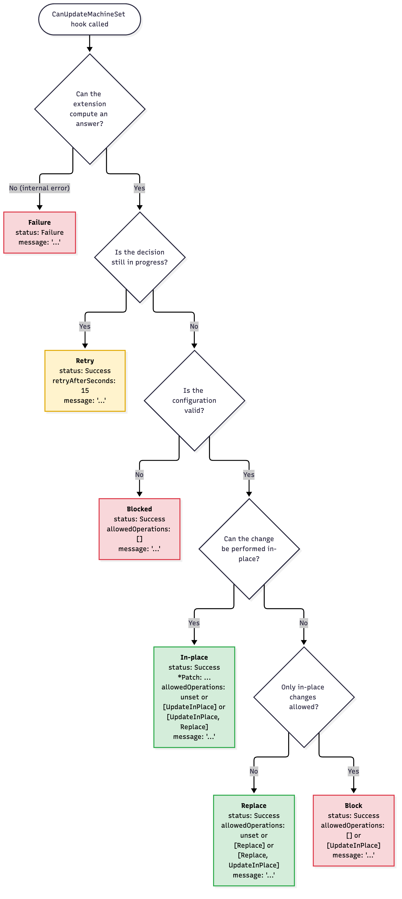
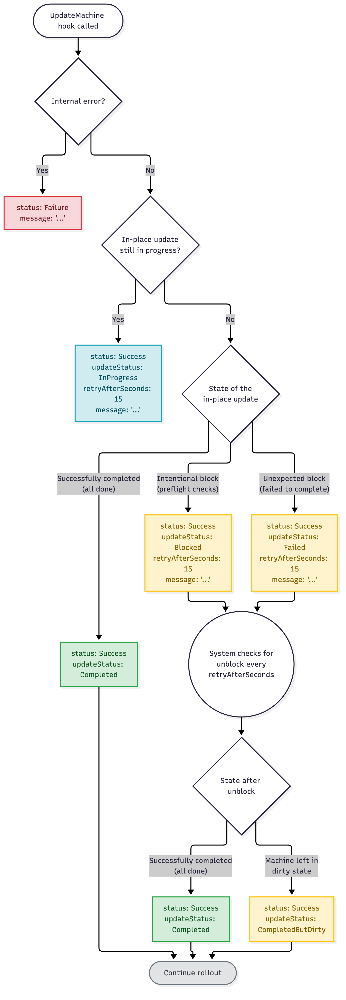

# Implementing In-Place Update Hooks

> [!IMPORTANT]
> Both the `RuntimeSDK` and the `InPlaceUpdates` feature gates must be set to true in order to use this feature.
> See [Feature Gates](../../reference/feature-gates.md) for more details.

> [!CAUTION]
> Please note Runtime SDK is an advanced feature. If implemented incorrectly, a failing Runtime Extension can severely impact the Cluster API runtime.

> [!CAUTION]
> For Clusters that have been created with CAPI <= v1.11 it will only be possible to unset fields during in-place updates after:
> * a regular rollout that replaces all Machines
> * an in-place update that updates all Machines
>
> For details see the PR description of [CAPI-12890](https://github.com/kubernetes-sigs/cluster-api/pull/12890) section "Migration from managedFields v1.11 => v1.12".

## Introduction

The proposal for [in-place updates in Cluster API](https://github.com/kubernetes-sigs/cluster-api/blob/main/docs/proposals/20240807-in-place-updates.md)
introduced extensions allowing users to execute changes on existing machines without deleting the Machine and creating a new one.

Notably, the Cluster API user experience remains the same as of today no matter of the in-place update feature is enabled 
or not e.g. in order to trigger a MachineDeployment rollout, you have to rotate a template, etc.

Users should care ONLY about the desired state (as of today).

Cluster API is responsible to choose the best strategy to achieve desired state, and with the introduction of 
update extensions, Cluster API is expanding the set of tools that can be used to achieve the desired state.

If external update extensions can not cover the totality of the desired changes, CAPI will fall back to Cluster API’s default, 
replace machines (immutable rollouts).

Cluster API will be also responsible to determine which Machine/MachineSet should be updated, as well as to handle rollout
options like MaxSurge/MaxUnavailable. With this regard:

- By default, in-place updates are considered as an operation that might affect machine availability, 
  because in-place updates are always considered as potentially disruptive.
  - For control plane machines, if maxSurge is 1, a new machine must be created first, then as soon as there is 
    “buffer” for in-place, in-place update can proceed.
    - KCP will not use in-place in case it will detect that it can impact health of the control plane.
  - For workers machines, if maxUnavailable is 0, a new machine must be created first, then as soon as there
    is “buffer” for in-place, in-place update can proceed.
    - When in-place is possible, the system should try to in-place update as many machines as possible.
      In practice, this means that maxSurge might not be fully used (it is used only for scale up by one if maxUnavailable=0).
- The `CanUpdateMachineResponse` or the `CanUpdateMachineSetResponse` hook can override the default behavior and specify 
  that the required change does not affect availability. In this case the in-place update will start immediately, without
  creating an additional machine/using maxSurge (if available)
  - **Warning!** the system is going to perform in-place update on the first Machine without the safety net provided by the additional machine.
  - If something goes wrong unexpectedly, and the operation leads to actual unavailability, control plane components or workloads could be impacted.
  - **Use this feature with caution!**
- The `CanUpdateMachineResponse` or the `CanUpdateMachineSetResponse` hook can also be used to express a binding opinion on which operations 
  can be used to roll out the changes for the Machine or for Machines controlled by the MachineSet.
  - This opinion can be used to block the rollout under temporary circumstances: e.g. preflight checks fail.
  - Please note that some limitations apply, see documentation below.
- No in-place updates are performed for workers machines when using rollout strategy `OnDelete`.

> [!IMPORTANT]
> Cluster API will call the in-place extensions only if the `InPlaceUpdates` feature flag is enabled.
>
> Also, please note that the current implementation of the [in-place updates proposal](https://github.com/kubernetes-sigs/cluster-api/blob/main/docs/proposals/20240807-in-place-updates.md) only allows registering one extension for the `CanUpdateMachine`, `CanUpdateMachineSet` and `UpdateMachine` hooks.

## Guidelines

All guidelines defined in [Implementing Runtime Extensions](implement-extensions.md#guidelines) apply to the
implementation of Runtime Extensions for in-place update hooks as well.

In summary, Runtime Extensions are components that should be designed, written and deployed with great caution given
that they can affect the proper functioning of the Cluster API runtime. A poorly implemented Runtime Extension could
potentially block updates.

Following recommendations are especially relevant:

* [Timeouts](implement-extensions.md#timeouts)
* [Idempotence](implement-extensions.md#idempotence)
* [Deterministic result](implement-extensions.md#deterministic-result)
* [Error messages](implement-extensions.md#error-messages)
* [Error management](implement-extensions.md#error-management)
* [Avoid dependencies](implement-extensions.md#avoid-dependencies)

## Definitions

For additional details about the OpenAPI spec of the upgrade plan hooks, please download the [`runtime-sdk-openapi.yaml`]({{#releaselink repo:"https://github.com/kubernetes-sigs/cluster-api" gomodule:"sigs.k8s.io/cluster-api" asset:"runtime-sdk-openapi.yaml" version:"1.12.x"}})
file and then open it from the [Swagger UI](https://editor.swagger.io/).

### CanUpdateMachine

> [!IMPORTANT] The CanUpdateMachine hook MUST be implemented by control plane providers that
> are using Cluster API Machines to represent replicas and supporting in-place updates for those replicas.
> 
> The documentation in this paragraph focuses on the reference implementation in the KubeadmControlPlane (KCP) provider, 
> but the behavior of the CanUpdateMachine hook MUST be the same also when implemented by other control plane providers.

This hook is called by KCP when performing the "can update in-place" for a control plane machine.

Example request:

```yaml
apiVersion: hooks.runtime.cluster.x-k8s.io/v1alpha1
kind: CanUpdateMachineRequest
settings: <Runtime Extension settings>
current:
  machine:
    apiVersion: cluster.x-k8s.io/v1beta2
    kind: Machine
    metadata:
      name: test-cluster
      namespace: test-ns
    spec:
      ...
  infrastructureMachine:
    apiVersion: infrastructure.cluster.x-k8s.io/v1beta1
    kind: VSphereMachine
    metadata:
      name: test-cluster
      namespace: test-ns
    spec:
      ...
  boostrapConfig:
    apiVersion: bootstrap.cluster.x-k8s.io/v1beta1
    kind: KubeadmConfig
    metadata:
      name: test-cluster
      namespace: test-ns
    spec:
      ...
desired:
  machine:
    ...
  infrastructureMachine:
    ...
  boostrapConfig:
    ...
```

Note:
- All the objects will have the latest API version known by Cluster API.
- Only spec is provided, status fields are not included
- In a future release, when registering more than one extension for the `CanUpdateMachine` will be supported, the current state will already include changes that can be handled in-place by other runtime extensions.

Example Response:

```yaml
apiVersion: hooks.runtime.cluster.x-k8s.io/v1alpha1
kind: CanUpdateMachineResponse
status: Success # or Failure
message: "error message if status == Failure"
retryAfterSeconds: 15 # Set retryAfterSeconds > 0 if a decision cannot be made yet
machinePatch:
  patchType: JSONPatch
  patch: <JSON-patch>
infrastructureMachinePatch:
  ...
boostrapConfigPatch:
  ...
affectsAvailability: true
allowedOperations: [UpdateInPlace, Replace] # optional, if missing all operations are allowed
```

Note: 
- Extensions should return per-object patches to be applied on current objects to indicate which changes they can handle in-place.
- Only fields in Machine/InfraMachine/BootstrapConfig spec have to be covered by patches
- Patches must be in JSONPatch or JSONMergePatch format
- If `retryAfterSeconds` is set to a non-zero value, the extension signals that it is not yet able to decide if the change can be handled in-place.
  The other fields of the response are ignored, no fallback to machine replace is performed and the hook will be called again after the given amount of seconds.
- `affectsAvailability` is an optional value, if missing it defaults to true.
- When `CanUpdateMachineResponse` hook specifies that the required change does not affect availability, the in-place update will start immediately, without creating an additional machine/using maxSurge (if available)
  - **Warning!** the system is going to perform in-place update on the first Machine without the safety net provided by the additional machine.
  - If something goes wrong unexpectedly, and the operation leads to actual unavailability, control plane components could be impacted.
  - **Use this feature with caution!**
- If using KCP, KCP might override the `CanUpdateMachineResponse` and decide to scale up or down when this will be considered safer than performing in place to preserve the overall control plane health (e.g. when
  there are unhealthy machines).
- `allowedOperations` is an optional value that allows the extension to express a binding opinion on which operations can be used to roll out the changes to the Machine:
  - `UpdateInPlace`: the Machine can be updated in-place.
  - `Replace`: the Machine can be replaced (i.e. a new Machine is created and the old one is deleted).
  - If `allowedOperations` is not set, the extension has no opinion and all operations are allowed (this is the default).
  - If `allowedOperations` is set to an empty list (`allowedOperations: []`), no operation is allowed and the rollout of the Machine is blocked.
    **Note**: an empty list and a missing field have a different meaning. When implementing an extension in Go using the types in `sigs.k8s.io/cluster-api/api/runtime/hooks/v1alpha1`
    an empty list must be a non-nil empty slice, e.g. `new([]runtimehooksv1.MachineUpdateOperation{})`.
  - `allowedOperations` is independent of the patches returned by the extension: patches tell which changes can be handled in-place, `allowedOperations` tells which operations are allowed.
    A runtime extension can e.g. block a rollout when a preflight check fails, even if it would be able to handle the changes in-place.
    A runtime extension can e.g. also cover the entire diff but return `allowedOperations: [Replace]`, then KCP would replace the Machine.
  - When the update is blocked the extension is called again every 5 minutes, so it is possible to unblock the rollout by changing the answer.
    The answer is also evaluated again when the desired state of KCP is changed.

Below is the decision tree that `CanUpdateMachine` implementers can use to compute the answer for a complex use case:


##### When the hook is called

The CanUpdateMachine extension will be called only if we have outdated replicas (so it can block/express an opinion in following cases):

- Before scaling down, so we can perform in-place if KCP preflight checks are passing and in-place is supported for these changes
  - Exception: If only this Machine is failing KCP preflight checks we are always going to delete it (it is risky to in-place update a machine not healthy, so replace it)
- Before using maxSurge (scaling up above replica number), so we can avoid creating spare nodes / consider affectsAvailability

##### When the hook is not called

The CanUpdateMachine extension will NOT be called in the following cases (so it cannot block in following cases):

- if we don’t have outdated replicas
- if we have outdated replicas and
  - If there are already enough up-to-date replicas, because at that point we only have to delete outdated Machines
  - If we have to scale up after a remediation
  - If we have to scale up because we are below min replicas (e.g CP scaled up)
  - If we have to scale up because we are below spec.replicas (e.g. after a delete during a rollout)
  - If we have to scale down because we are above max replicas (e.g. CP scaled down)
  - If the replica to be rolled out is not eligible for in-place update, i.e. in one of the following cases: delete-machine or remediate-machine annotation is set, rollout.before or rollout.after triggers

> [!IMPORTANT]
> `allowedOperations` only constrains decisions taken while the hook is consulted. 

### CanUpdateMachineSet

This hook is called by the MachineDeployment controller when performing the "can update in-place" for all the Machines controlled by
a MachineSet.

Example request:

```yaml
apiVersion: hooks.runtime.cluster.x-k8s.io/v1alpha1
kind: CanUpdateMachineSetRequest
settings: <Runtime Extension settings>
current:
  machineSet:
    apiVersion: cluster.x-k8s.io/v1beta2
    kind: MachineSet
    metadata:
      name: test-cluster
      namespace: test-ns
    spec:
      ...
  infrastructureMachineTemplate:
    apiVersion: infrastructure.cluster.x-k8s.io/v1beta1
    kind: VSphereMachineTemplate
    metadata:
      name: test-cluster
      namespace: test-ns
    spec:
      ...
  boostrapConfigTemplate:
    apiVersion: bootstrap.cluster.x-k8s.io/v1beta1
    kind: KubeadmConfigTemplate
    metadata:
      name: test-cluster
      namespace: test-ns
    spec:
      ...
desired:
  machineSet:
    ...
  infrastructureMachineTemplate:
    ...
  boostrapConfigTemplate:
    ...
```

Note:
- All the objects will have the latest API version known by Cluster API.
- Only spec is provided, status fields are not included
- In a future release, when registering more than one extension for the `CanUpdateMachineSet` will be supported, the current state will already include changes that can be handled in-place by other runtime extensions.

Example Response:

```yaml
apiVersion: hooks.runtime.cluster.x-k8s.io/v1alpha1
kind: CanUpdateMachineSetResponse
status: Success # or Failure
message: "error message if status == Failure"
retryAfterSeconds: 15 # Set retryAfterSeconds > 0 if a decision cannot be made yet
machineSetPatch:
  patchType: JSONPatch
  patch: <JSON-patch>
infrastructureMachineTemplatePatch:
  ...
boostrapConfigTemplatePatch:
  ...
affectsAvailability: true
allowedOperations: [UpdateInPlace, Replace] # optional, if missing all operations are allowed
```

Note:
- Extensions should return per-object patches to be applied on current objects to indicate which changes they can handle in-place.
- Only fields in MachineSet/InfraMachineTemplate/BootstrapConfigTemplate spec.template.spec have to be covered by patches
- Patches must be in JSONPatch or JSONMergePatch format
- If `retryAfterSeconds` is set to a non-zero value, the extension signals that it is not yet able to decide if the change can be handled in-place.
  The other fields of the response are ignored, no fallback to machine replace is performed and the hook will be called again after the given amount of seconds.
  - While the decision is still in progress for at least one MachineSet, the rollout is paused for the entire MachineDeployment: 
    - Machines are not scaled down (or moved) from old MachineSet and no additional Machines are created on the new MachineSet because of `maxSurge`. 
    - Scale up/down due to changes to the MachineDeployment `spec.replicas` still happen.
      - When scaling down, excess Machines are deleted (oldest MachineSet first); they are never moved to the new MachineSet to be updated in-place, because the decision is not known yet.
      - When scaling up, `maxSurge` is not used.
- `affectsAvailability` is an optional value, if missing it defaults to true.
- When `CanUpdateMachineSetResponse` specifies that the required change does not affect availability, the in-place update will start immediately, without creating an additional machine/using maxSurge (if available)
  - **Warning!** the system is going to perform in-place update on the first Machine without the safety net provided by the additional machine.
  - If something goes wrong unexpectedly, and the operation leads to actual unavailability, workloads could be impacted.
  - **Use this feature with caution!**
- `allowedOperations` is an optional value that allows the extension to express a binding opinion on which operations can be used to roll out the changes for the Machines controlled by the MachineSet:
  - `UpdateInPlace`: the controlled Machines can be updated in-place.
  - `Replace`: the controlled Machines can be replaced (i.e. a new Machine is created and the old one is deleted).
  - If `allowedOperations` is not set, the extension has no opinion and all operations are allowed (this is the default).
  - If `allowedOperations` is set to an empty list (`allowedOperations: []`), no operation is allowed and the rollout for the Machines controlled by the MachineSet is blocked.
    **Note**: an empty list and a missing field have a different meaning. When implementing an extension in Go using the types in `sigs.k8s.io/cluster-api/api/runtime/hooks/v1alpha1`
    an empty list must be a non-nil empty slice, e.g. `new([]runtimehooksv1.MachineUpdateOperation{})`.
  - `allowedOperations` is independent of the patches returned by the extension: patches tell which changes can be handled in-place, `allowedOperations` tells which operations are allowed.
    A runtime extension can e.g. block a rollout for the Machines controlled by the MachineSet when a preflight check fails, even if it would be able to handle the changes in-place.
    A runtime extension can e.g. also cover the entire diff but return `allowedOperations: [Replace]`, then the MachineDeployment would replace the Machines.
- When the update is blocked the extension is called again every 5 minutes, so it is possible to unblock the rollout by changing the answer.
  The answer is also evaluated again when the desired state of the MachineDeployment is changed.
- The new MachineSet has no `CanUpdateMachineSet` call, and the usage of `maxSurge` is allowed or blocked according to the following rules:
  - If at least one old MachineSet is updated in-place, the usage of `maxSurge` is considered part of the in-place update operation.
    - If the `UpdateInPlace` is blocked by all the old MachineSets, usage of `maxSurge` is blocked as well.
  - Otherwise, if at least one old MachineSet is rolled out (including fallbacks from in-place update), usage of `maxSurge` is considered part of the replace operation. 
    - If the `Replace` operation is blocked by all the old MachineSets, usage of `maxSurge` is blocked as well.
  - If instead all the old MachineSets are blocked, usage of `maxSurge` is blocked as well.

Below is the decision tree that `CanUpdateMachineSet` implementers can use to compute the answer for a complex use case:



#### How the MachineDeployment controller uses the CanUpdateMachineSet hook

A MachineDeployment can have Machines from different template revisions at the same time. Each revision is controlled by
its own MachineSet: the newest is the new MachineSet, and all the others are old MachineSets.

While rolling out changes, Cluster API must also account for other concurrent operations, such as scaling up or remediating unhealthy Machines.

##### When the hook is called

The hook is called once for each old MachineSet that still has Machines and is eligible for in-place updates.
The answer can differ for each MachineSet:

```
MachineDeployment, template revision 3

  MS-A (rev 1)                 --hook--> cannot be updated in-place  => Replace
  MS-B (rev 2)                 --hook--> can be updated in-place     => UpdateInPlace (Machines move to MS-C)
  MS-C (rev 3, new MachineSet) never asked, its Machines are already up-to-date
```

##### When the hook is not called

- The `InPlaceUpdates` feature gate is disabled, or no `CanUpdateMachineSet` extension is registered. The rollout is a regular one.
- The old MachineSet has no Machines left, so there is nothing to do.
- The old MachineSet is not eligible for in-place updates:
  - The rollout is triggered by `spec.rollout.after`. All the Machines must be replaced in that case.
  - The MachineSet is a discarded candidate for the new MachineSet.
- The new MachineSet already has all the desired replicas (`newMS.spec.replicas >= md.spec.replicas`).
  The only work left is deleting outdated Machines, so more in-place updates make no sense.
- The deadlock breaker scales down an old MachineSet. A rollout is "stuck" when:
  - some Machines of the old MachineSets are unavailable;
  - the new MachineSet is fully available;
  - no scale operation is in progress or planned.

  The deadlock breaker is skipped if any old MachineSet is pending or blocked.

> [!IMPORTANT]
> `allowedOperations` only constrains decisions taken while the hook is consulted. 

##### How the answers are combined

The `CanUpdateMachineSet` hook is called once for each old MachineSet (see above).
Depending on the answer, the outcome applies to that single MachineSet or to the rollout of the entire MachineDeployment:

| CanUpdateMachineSetResponse                                                                                                                | Outcome                                                                                                                                                                                            | `RollingOut` condition reason |
|:-------------------------------------------------------------------------------------------------------------------------------------------|:---------------------------------------------------------------------------------------------------------------------------------------------------------------------------------------------------|:------------------------------|
| `status: Success`, `retryAfterSeconds` > 0 (e.g. 15), `message`                                                                            | Decision pending: the rollout of the entire MachineDeployment is paused; the result is cached and the hook is called again after `retryAfterSeconds`. `allowedOperations` and patches are ignored. | `WaitingForRolloutDecision`   |
| `status: Success`, patches cover the entire diff, `allowedOperations` unset, or contains `UpdateInPlace` (with or without `Replace`)       | `UpdateInPlace` operation will be used for this MachineSet: in-place possible and allowed. `affectsAvailability` only influences the use of `maxSurge`.                                            | `RollingOut`                  |
| `status: Success`, patches cover the entire diff, `allowedOperations: [Replace]`                                                           | `Replace` operation will be used for this MachineSet: `UpdateInPlace` is possible but not allowed, so Cluster API falls back to `Replace`.                                                         | `RollingOut`                  |
| `status: Success`, patches don't cover the entire diff, `allowedOperations` unset, or contains `Replace` (with or without `UpdateInPlace`) | `Replace` operation will be used for this MachineSet: `UpdateInPlace` is not possible and `Replace` is allowed.                                                                                    | `RollingOut`                  |
| `status: Success`, patches don't cover the entire diff, `allowedOperations: [UpdateInPlace]`                                               | Rollout is blocked for this MachineSet: `UpdateInPlace` is not possible and `Replace` is not allowed.                                                                                              | `RolloutBlocked`              |
| `status: Success`, `allowedOperations: []` (patches and `affectsAvailability` don't matter)                                                | Rollout is blocked for this MachineSet: no operation is allowed.                                                                                                                                   | `RolloutBlocked`              |
| `status: Failure`, `message`                                                                                                               | Internal error while calling the hook; the reconcile fails and is retried with exponential backoff.                                                                                                | `InternalError`               |

Effects on the rollout:
- Pending pauses everything.
  - The planner can't decide how to use `maxSurge` or how to optimize for in-place without all the answers.
  - It blocks scale down of the outdated replicas from all the old MachineSets and also blocks the part of the new MachineSet scale up that uses `maxSurge`. Scale up/down due to changes to MachineDeployment spec.replicas still happen.
  - It keeps scale up caused by `spec.replicas` changes, and moves already in progress, so concurrent operations like scale up still work.
  - The MachineDeployment is requeued at the latest `retryAfter` of the pending MachineSets. Results are cached until then, so the pause can't lift earlier.
- Blocked is per MachineSet.
  - Each blocked old MachineSet drops only its own scale down intent. The other old MachineSets keep rolling out.
  - The MachineDeployment is requeued at the earliest cache expiry (5 minutes after the call), so one MachineSet can unblock without waiting for the others.
- `maxSurge` follows the operation being performed, because the hook is never called for the new MachineSet:
  - If any old MachineSet is updated in-place, `maxSurge` is part of the in-place operation.
  - Otherwise, if any old MachineSet is replaced (including fallbacks from in-place), it is part of the replace operation.
  - If every old MachineSet is blocked, `maxSurge` is blocked too.

Notes:
- "patches cover the entire diff" means that `machineSetPatch`, `infrastructureMachineTemplatePatch` and
  `bootstrapConfigTemplatePatch` together make the current MachineSet match the desired one.
- `allowedOperations` unset is equivalent to `[UpdateInPlace, Replace]`. `allowedOperations: []` means that no operation is allowed.
- The reason applies to the whole MachineDeployment and only while some Machines are rolling out. With several MachineSets, the precedence is
  `InternalError` > `WaitingForRolloutDecision` > `RolloutBlocked` > `RollingOut`.
  For example, one pending MachineSet makes the MachineDeployment report `WaitingForRolloutDecision`.
- `message` is added to the condition message for the pending, blocked and internal error cases, together with the MachineSet name. In the other cases it only appears in logs.

### UpdateMachine

This hook is called by the Machine controller when performing the in-place updates for a Machine.

The hook is called only after the owner controller (KCP or MachineSet) decided to update the Machine in-place, i.e. after the
[CanUpdateMachine](#canupdatemachine) or [CanUpdateMachineSet](#canupdatemachineset) hooks said that the changes can be handled
in-place and `allowedOperations` allows the `UpdateInPlace` operation. At that point:
- The owner controller writes the desired state of the Machine, InfraMachine and BootstrapConfig, sets the `in-place-updates.internal.cluster.x-k8s.io/update-in-progress` annotation on them,
  and marks the `UpdateMachine` hook as pending on the Machine.
- The Machine controller starts calling the `UpdateMachine` hook as soon as the Machine is running (infrastructure provisioned, bootstrap data created, node ref set)
  and the annotation is set on the Machine, the InfraMachine and the BootstrapConfig.

Neither `CanUpdateMachine` nor `CanUpdateMachineSet` are called again for a Machine while its in-place update is in progress, so
`allowedOperations` has no effect on an update that already started.

Example request:

```yaml
apiVersion: hooks.runtime.cluster.x-k8s.io/v1alpha1
kind: UpdateMachineRequest
settings: <Runtime Extension settings>
desired:
  machine:
    apiVersion: cluster.x-k8s.io/v1beta2
    kind: Machine
    metadata:
      name: test-cluster
      namespace: test-ns
    spec:
      ...
  infrastructureMachine:
    apiVersion: infrastructure.cluster.x-k8s.io/v1beta1
    kind: VSphereMachine
    metadata:
      name: test-cluster
      namespace: test-ns
    spec:
      ...
  boostrapConfig:
    apiVersion: bootstrap.cluster.x-k8s.io/v1beta1
    kind: KubeadmConfig
    metadata:
      name: test-cluster
      namespace: test-ns
    spec:
      ...
```

Note:
- Only desired is provided (the external updater extension should know current state of the Machine).
- Only spec is provided, status fields are not included

Example Response:

```yaml
apiVersion: hooks.runtime.cluster.x-k8s.io/v1alpha1
kind: UpdateMachineResponse
status: Success # or Failure
updateStatus: InProgress # InProgress, Completed, Failed, Blocked or CompletedButDirty
message: ...
retryAfterSeconds: 10
```

Below a table with all the possible answer and the implications on the rollout process

| UpdateMachineResponse                                                      | Meaning                                                                                                               | Rollout can proceed |
|:---------------------------------------------------------------------------|:----------------------------------------------------------------------------------------------------------------------|:--------------------|
| `status: Failure`, `message`                                               | Internal error while computing the response.                                                                          | No                  |
| `status: Success`, `updateStatus: InProgress`, `retryAfterSeconds`         | The in-place update is still in progress.                                                                             | No                  |
| `status: Success`, `updateStatus: Completed`                               | The in-place update completed successfully.                                                                           | Yes                 |
| `status: Success`, `updateStatus: Blocked`, `retryAfterSeconds`, `message` | The in-place update is intentionally blocked (e.g. preflight checks).                                                 | No                  |
| `status: Success`, `updateStatus: Failed`, `retryAfterSeconds`, `message`  | The in-place update is blocked unexpectedly, because it failed to complete.                                           | No                  |
| `status: Success`, `updateStatus: CompletedButDirty`                       | The in-place update was recovered with manual intervention on the Machine, and the Machine might be in a dirty state. | Yes                 |

Below is the decision tree that `UpdateMachine` implementers can use to compute the answer:



Notes:
- While the update is in progress, the `Updating` condition surfaces `updateStatus` using different reason; the message also reports if the update affects availability.
- `retryAfterSeconds` > 0, the hook is not called again before the given amount of seconds; the `message` is surfaced in the `Updating` condition of the Machine.
- If the hook returns `Status=Failure` (or the call fails), the reconcile of the Machine fails and it is retried with exponential backoff.
- Only `Completed` and `CompletedButDirty` allow the rollout to proceed.
- In all the other cases CAPI keeps calling the `UpdateMachine` hook, so it can detect a manual recovery, but it slows down the retries and avoids unnecessary requests when possible (see `retryAfterSeconds`).
  - The hook is called repeatedly until the update completes, so it MUST be idempotent: the request only contains the desired state, and the extension
    is responsible for comparing it with the current state of the Machine and for performing the necessary actions.
- The fact that a Machine is "dirty" after a manual recovery is only tracked in an annotation and surfaced in a condition. CAPI does not implement default workflows for dirty Machines;
  if this is considered in the future, it should rely on MachineHealthCheck instead of re-inventing the wheel.
